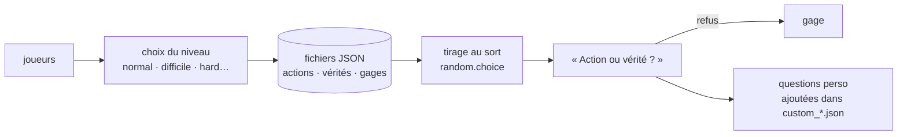

<div align="center">

# 🎮 Little games Python

**Mes premiers jeux en Python, créés pour jouer entre amis et apprendre la programmation.**


</div>

---

## ✨ Les jeux

| Jeu | Principe | Ce qu'il m'a appris |
|---|---|---|
| 🎯 **Juste Prix** | trouver un nombre mystère avec des indices « plus / moins » ; menu, règles, niveaux | boucles, conditions, aléatoire |
| ⭕ **Morpion** | à deux joueurs dans le terminal, détection des victoires | listes à deux dimensions, fonctions |
| 🃏 **Action ou Vérité** | thèmes de difficulté, gages, joueurs nommés ; la v2 charge ses questions depuis des fichiers JSON | structurer des données, fichiers |
| ✊ **Pierre-Feuille-Ciseaux** | contre l'ordinateur, qu'on peut nommer | logique de comparaison |
| ⚔️ **Combat** | duel au tour par tour contre l'ordinateur : attaque, potions, points de vie | état d'une partie |
| ❓ **Quiz** | culture générale, réponses commentées | enchaînement de questions |
| 🎡 **Roue** | tire au sort un joueur | `random.choice` |
| 🏎️ **Course** | petit jeu de voiture en fenêtre graphique | boucle de jeu, événements, Pygame |

---

## 🚀 Jouer

```bash
git clone https://github.com/Flavien-Audinet/Little-games-python.git
cd Little-games-python
python3 juste-prix/juste_prix.py
python3 action-ou-verite/v2/action_ou_verite.py
pip install pygame && python3 course-voiture/course_voiture.py
```

---

## ⚙️ Comment ça marche — Action ou Vérité v2



Les questions sont séparées du code : on peut ajouter ses propres actions et vérités sans toucher au programme.

---

## 🗂️ Organisation des fichiers

```
Little-games-python/
├── juste-prix/
│   ├── juste_prix.py            version complète (menu, règles, niveaux)
│   ├── juste_prix_simple.py     première version
│   └── juste_prix_max.py        borne maximale choisie par le joueur
├── morpion/morpion.py
├── action-ou-verite/
│   ├── v1/                      questions écrites dans le code
│   └── v2/                      questions dans des fichiers JSON par niveau
├── pierre-feuille-ciseaux/pierre_feuille_ciseaux.py
├── combat/combat.py
├── quiz/quiz.py
├── roue/roue.py
└── course-voiture/course_voiture.py   (Pygame)
```

---

## 💻 Compatibilité

| | |
|---|---|
| **Systèmes** | Windows, macOS, Linux |
| **Python** | 3.9 ou plus récent ; `pygame` pour la course |

---

## 📜 Licence

MIT — voir [LICENSE](LICENSE).

---

<div align="center"><sub>Python · premiers projets · à jouer entre amis</sub></div>
